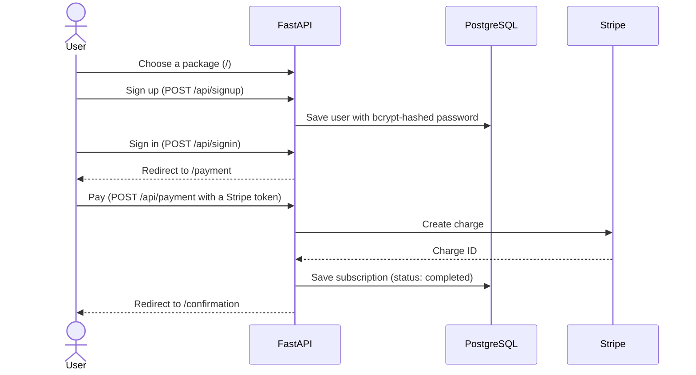

# SaaS Subscription Flow (FastAPI + Stripe)


A complete subscription purchase flow: pick a package, create an account or sign in, pay with Stripe, and see a confirmation. The backend is FastAPI with PostgreSQL. The frontend is HTML, CSS and JavaScript served by FastAPI, with icons and an animated package selection page.

```text
Package selection → Sign up (new user) or Sign in (existing user) → Stripe payment → Confirmation
```

## Features

- **Three packages** (Basic $9.99, Standard $19.99, Premium $29.99), configured in one place in `main.py`
- **Sign up and sign in** that carry the selected package through the flow. Duplicate emails are rejected, and passwords need at least 6 characters.
- **Password hashing** with bcrypt (passlib)
- **Stripe payments**: charges are created through the Stripe API in test mode, and card declines and other Stripe errors return clear messages
- **Subscription records**: each successful payment is saved with its Stripe payment ID and status
- **JSON endpoints** for packages, users and subscriptions
- **Responsive UI** with the Inter font, icons and animations

## Tech stack

| Layer | Tools |
|---|---|
| Backend | FastAPI, Pydantic, Uvicorn |
| Database | PostgreSQL, SQLAlchemy |
| Payments | Stripe Python SDK (test mode) |
| Auth | passlib + bcrypt for passwords, JWT helpers (python-jose) in `auth.py` |
| Frontend | HTML, CSS, JavaScript |

## How it works



## Project structure

```text
├── main.py             # FastAPI app: pages, API endpoints, Stripe payments, package config
├── auth.py             # bcrypt hashing and JWT helpers
├── models.py           # User and Subscription tables
├── database.py         # PostgreSQL connection (DATABASE_URL)
├── index.html          # package selection
├── signup.html         # create an account
├── signin.html         # sign in
├── payment.html        # Stripe test payment
├── confirmation.html   # success page
├── static/
│   ├── styles.css
│   └── scripts.js
├── requirements.txt
└── .env.example
```

## Getting started

**Requirements:** Python 3.10+, PostgreSQL and a free [Stripe](https://stripe.com) account.

### 1. Create the database

```sql
CREATE DATABASE subscription_db;
```

### 2. Install

```bash
python -m venv venv
venv\Scripts\activate          # macOS/Linux: source venv/bin/activate
pip install -r requirements.txt
```

### 3. Configure

Copy `.env.example` to `.env` and fill in the values:

| Variable | Description |
|---|---|
| `DATABASE_URL` | PostgreSQL connection string |
| `SECRET_KEY` | Secret for signing JWT tokens |
| `STRIPE_SECRET_KEY` | Your Stripe **test** secret key (Stripe Dashboard → Developers → API keys, with Test mode on) |

### 4. Run

```bash
uvicorn main:app --reload
```

Open http://127.0.0.1:8000. Tables are created automatically on first start.

## Testing payments

The payment page takes a Stripe **test token** instead of a card number. Use one of these:

| Token | Result |
|---|---|
| `tok_visa` | Success (Visa) |
| `tok_mastercard` | Success (Mastercard) |
| `tok_amex` | Success (American Express) |
| `tok_chargeDeclined` | Card declined |
| `tok_chargeDeclinedInsufficientFunds` | Declined: insufficient funds |

Charges show up in your Stripe Dashboard under **Payments** in test mode.

## Pages and API

| Method | Route | Description |
|---|---|---|
| `GET` | `/` | Package selection page |
| `GET` | `/signup?package=` | Sign-up page |
| `GET` | `/signin?package=` | Sign-in page |
| `GET` | `/payment?package=&user_id=` | Payment page |
| `GET` | `/confirmation` | Confirmation page |
| `POST` | `/api/signup` | Create an account (form data) |
| `POST` | `/api/signin` | Sign in and continue to payment (form data) |
| `POST` | `/api/payment` | Charge with Stripe and save the subscription (form: `user_id`, `package`, `token`) |
| `GET` | `/api/packages` | All packages with prices and features |
| `GET` | `/api/user/{user_id}` | User details (without the password) |
| `GET` | `/api/subscription/{user_id}` | The user's latest subscription |

## Database

| Table | Columns |
|---|---|
| `users` | `id`, `email` (unique), `password` (bcrypt hash), `full_name`, `created_at`, `is_active` |
| `subscriptions` | `id`, `user_id`, `package_name`, `price`, `stripe_payment_id`, `status`, `created_at` |

## Author

**Hassan Khursheed** · [github.com/hassankhursheed](https://github.com/hassankhursheed)
